# Pantry: selbst gehosteter Essensplaner, Vorratsschrank und Einkaufsliste für deinen Heimserver

[English](README.md) · **Deutsch**

[](https://github.com/kheirisaleh/pantry/actions/workflows/ci.yml)
[](LICENSE)


> **Du hast einen Server zu Hause und willst, dass deine Küchendaten dort bleiben? Dann ist dieses Projekt für dich.**
> Pantry plant die Mahlzeiten der Woche aus den Gerichten, die ihr wirklich kocht, weiß, was im Schrank steht,
> schreibt die Einkaufsliste aus der Differenz und sagt dir, was du heute Abend kochen kannst. Namen dürfen auf
> Englisch, Deutsch oder Persisch eingegeben werden. Alles läuft in einem Docker Container mit einer SQLite Datei.

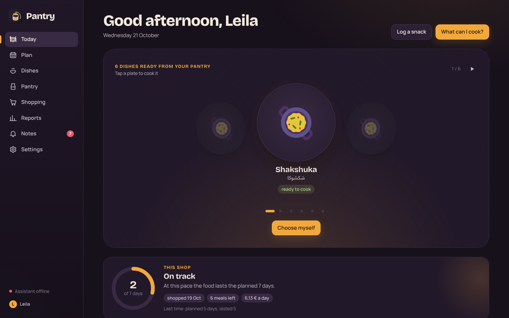

---

## Die Geschichte

Ein Haushalt, der in Deutschland persisch kocht, hat ein besonderes Problem. Das Rezept heißt „Loobia Polo",
der Supermarkt nennt die Bohnen „grüne Bohnen", jemand tippt „loobia" ins Handy und jemand anderes „لوبیا".
Viele Essensplaner setzen eine englische Rezeptdatenbank und ein Cloud Konto voraus, und keiner weiß, dass
noch eine halbe Tüte Reis von letzter Woche da ist.

Also haben wir den Planer gebaut, den wir wollten:

* **Er plant mit euren eigenen Gerichten.** Gericht und Zutaten pro Person eintippen, in jeder der drei Sprachen.
  Ein optionaler KI Assistent (Google Gemini) ergänzt im Hintergrund Namen in allen drei Sprachen, Kategorien,
  typische Stückgewichte, Nährwerte und ein Foto. Nichts muss auf ihn warten.
* **Er kennt den Vorrat.** Jeder Einkauf wird zu einer Charge mit Preis und Datum. Beim Kochen wird zuerst die
  älteste Charge verbraucht, so weißt du immer, was noch da ist und was jede Mahlzeit gekostet hat.
* **Die Einkaufsliste schreibt sich selbst.** Sie deckt genau die Mahlzeiten im gewählten Zeitraum ab, abzüglich
  dessen, was zu Hause ist, plus einen kleinen Puffer für frische Ware, gerundet auf Packungen und Stück, die
  man wirklich kaufen kann.
* **Er wohnt zu Hause.** Ein Container, eine SQLite Datei in `./data`, tägliche Backups, das Handy im selben WLAN.
  Im Supermarkt ohne Empfang funktioniert er weiter und holt alles nach, sobald du wieder online bist.

Wenn das nach deiner Küche klingt, lies weiter.

## Was es kann

### Heute: Was kann ich kochen?

Die Startseite zeigt die Gerichte, die mit dem Vorrat gerade möglich sind, und eine Prognose, wie lange der
letzte Einkauf bei eurem Tempo reicht. „What can I cook?" sortiert alle Gerichte: zuerst die möglichen, die den
restlichen Wochenplan nicht gefährden, dann die, die etwas für eine spätere Mahlzeit verbrauchen würden, dann
die, denen eine Zutat fehlt (mit genau dem, was fehlt).

| Vorschläge | Kochen |
| --- | --- |
| 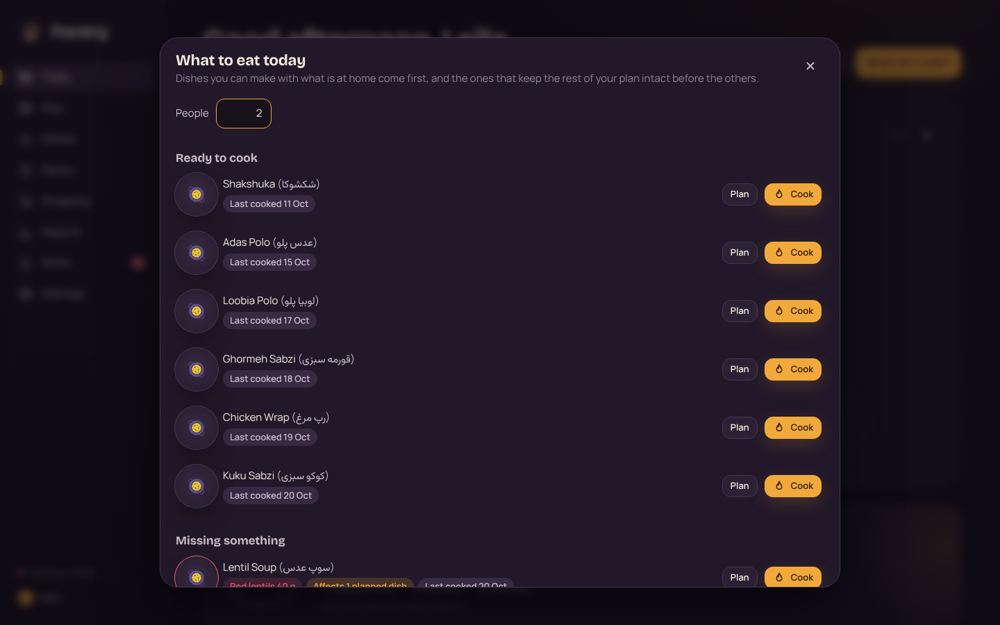 | 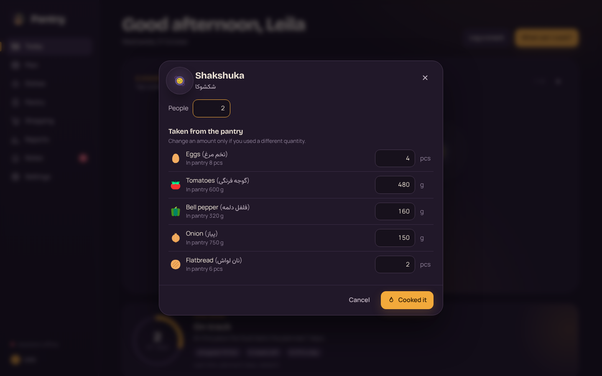 |

Beim Kochen kannst du die Personenzahl ändern, Alternativen wählen (Reis oder Bulgur), optionale Zutaten
dazunehmen und Mengen anpassen. Die Zutaten werden vom Vorrat abgezogen, die Kosten aus den echten
Einkaufspreisen berechnet und die Nährwerte pro Person gespeichert.

### Die Woche planen

Gerichte zwischen Tagen verschieben oder innerhalb eines Tages umsortieren. Eine Mahlzeit wird als knapp
markiert, wenn der Vorrat nicht reicht, unter Berücksichtigung aller früheren Mahlzeiten. Geplante, aber nicht
gekochte Mahlzeiten wandern um Mitternacht auf heute, statt zu verschwinden. Snacks lassen sich pro Person
erfassen.

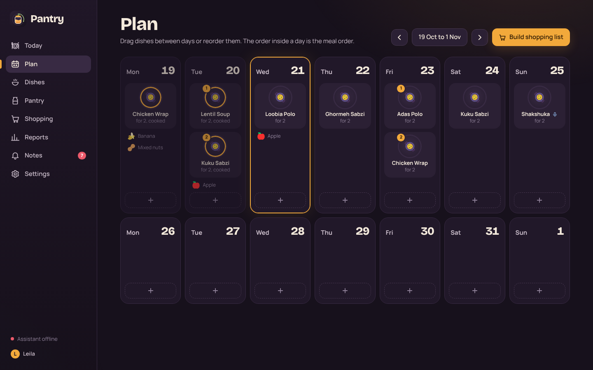

### Gerichte in drei Sprachen

Jedes Gericht hat Zutaten pro Person, Plätze mit Alternativen, optionale Extras und Zutaten, die pro Gericht
statt pro Person zählen. Fotos kommen von Wikipedia, Openverse oder Pexels und werden lokal gespeichert.

| Gerichte | Gericht bearbeiten |
| --- | --- |
| 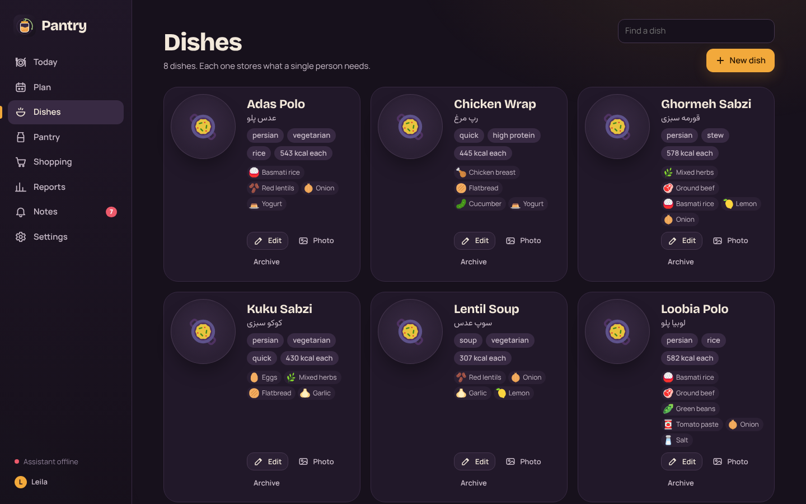 | 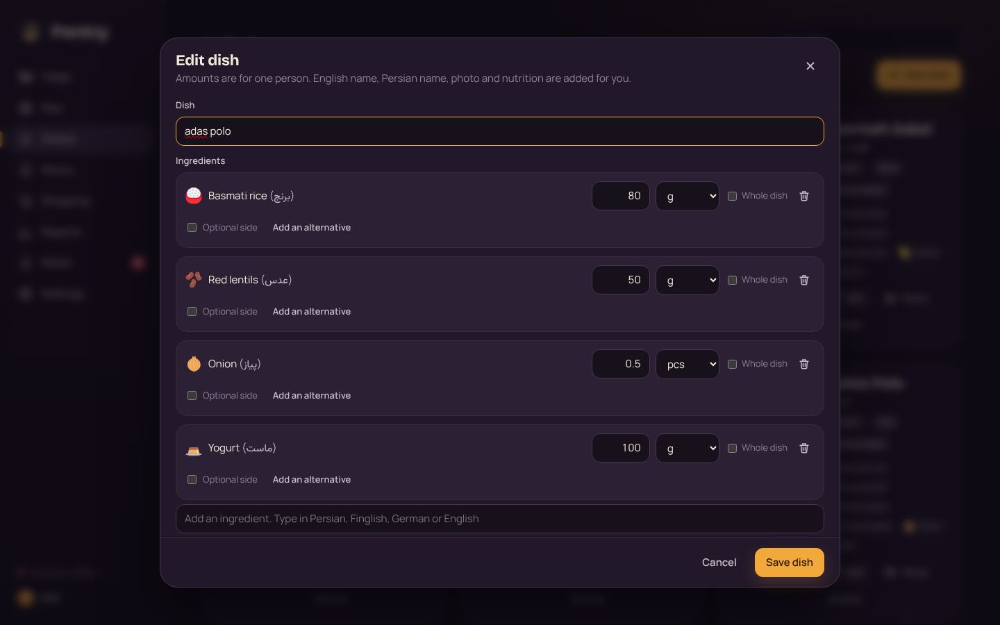 |

### Der Vorrat

Alles, was zu Hause ist, nach Kategorien, mit groben „bald verbrauchen" Hinweisen aus der typischen
Haltbarkeit. Ein Vorratscheck geht jede Zutat durch, damit du bestätigen kannst, was wirklich noch da ist;
Pantry erinnert alle zwei Wochen daran. Was aufgebraucht oder weggeworfen wird, fließt mit seinem Einkaufspreis
in die Berichte ein.

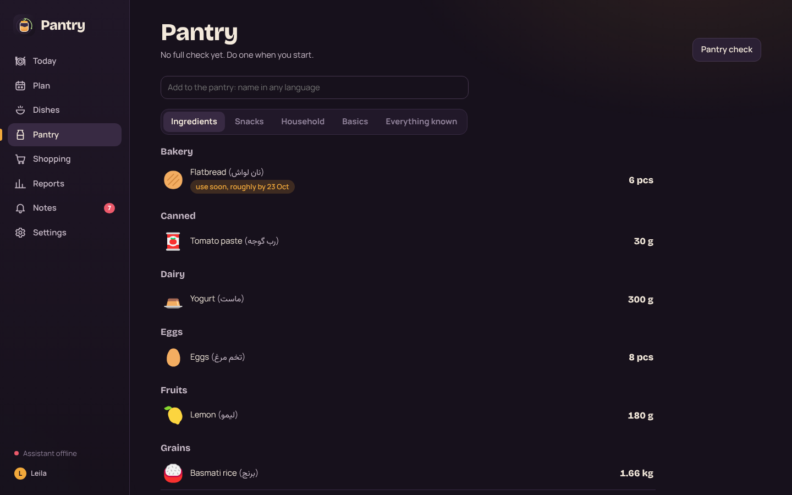

### Einkaufen ohne Empfang

Die Liste aus dem Plan für beliebige Tage erstellen, Extras von Hand ergänzen (in jeder Sprache) und im Laden
mit echter Menge und echtem Preis abhaken. Wer auf derselben Tour in einen zweiten Laden geht, startet dort eine
neue Sitzung, so behält jeder Laden seine eigenen Artikel und seine Summe. Bricht die Verbindung ab, werden
Änderungen gesammelt und gesendet, sobald sie wieder da ist. Beim Abschließen landet alles Gekaufte im Vorrat,
und Packungs und Stückgrößen werden aus deinen Eingaben gelernt.

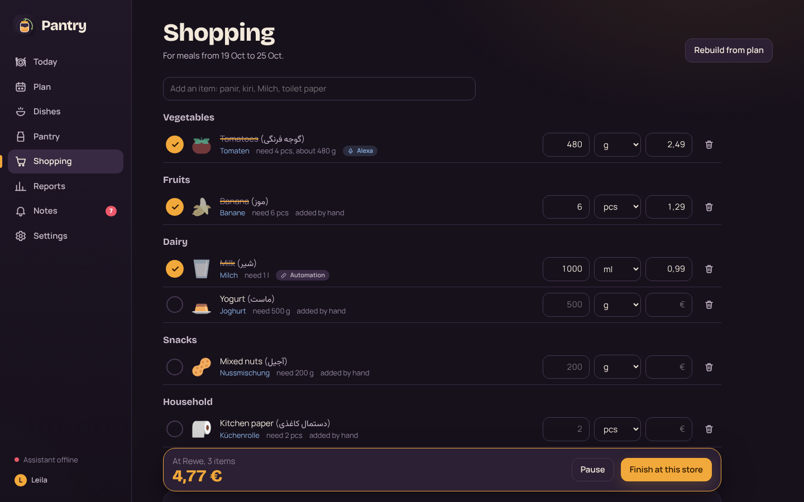

### Berichte

Ausgaben pro Tag, Woche oder Monat, nach Laden und Kategorie, Kosten pro gekochter Mahlzeit und pro Gericht,
Preisverlauf pro Artikel, Verschwendung, Nährwerte pro Person und ein Rückblick auf jeden Einkaufszeitraum: was
knapp wurde und was übrig blieb. Alles lässt sich als CSV oder als eine Excel Datei exportieren.

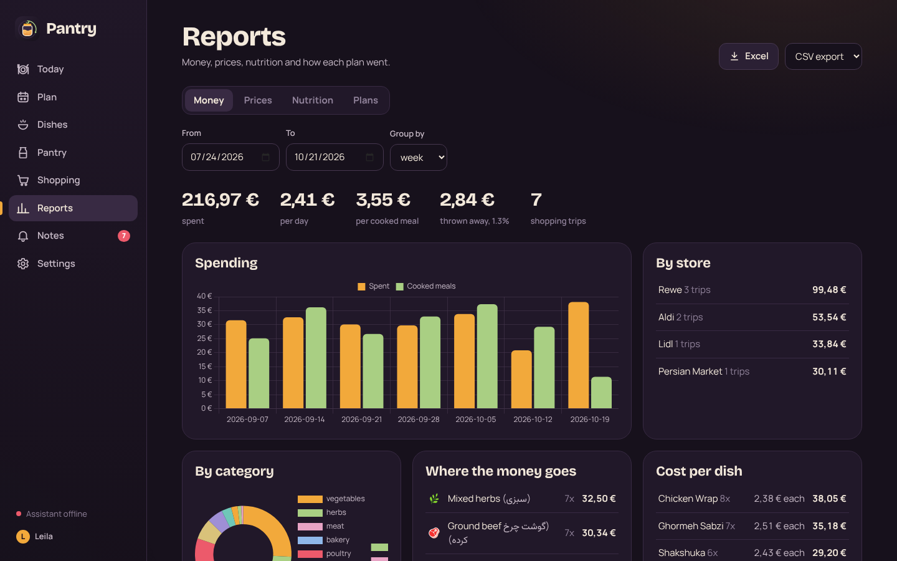

### Hinweise, Push und Alexa

Pantry hinterlässt Hinweise, wenn etwas wichtig ist: eine Zutat fehlt für morgen, etwas sollte bald verbraucht
werden, für die nächsten Tage ist nichts geplant, ein Einkaufszeitraum ist vorbei, der Einkauf reicht länger als
geplant. Mit aktivierten Push Benachrichtigungen kommen sie aufs Handy. Ein optionaler Alexa Skill liest und
füllt die Einkaufsliste, plant Gerichte und beantwortet „Haben wir noch Eier", auf Deutsch und Englisch
([docs/ALEXA.md](docs/ALEXA.md)).

| Hinweise | Einstellungen |
| --- | --- |
| 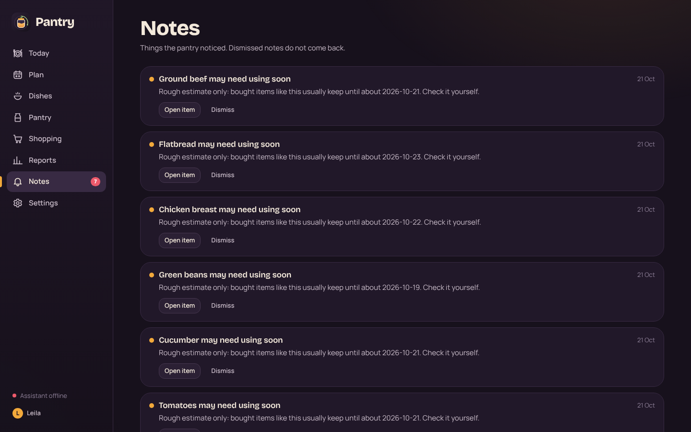 | 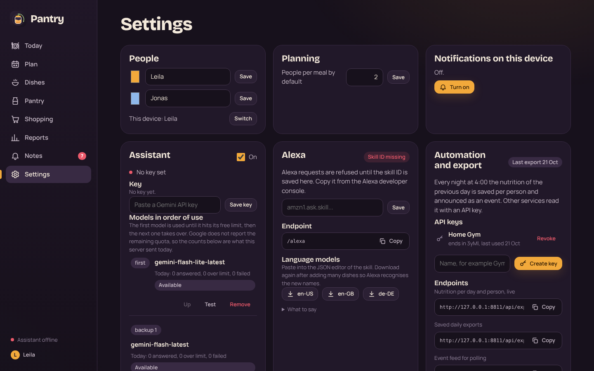 |

### Auf dem Handy

Die Handy Ansicht liegt unter `/m` und lässt sich als App zum Startbildschirm hinzufügen.

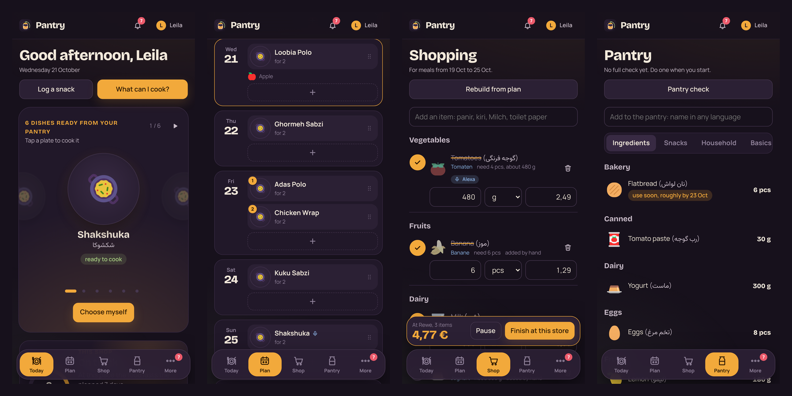

Die Oberfläche selbst ist auf Englisch; Zutaten und Gerichte zeigen ihre Namen auf Englisch, Deutsch und
Persisch.

## Passt gut zu: Home Gym

[Home Gym](https://github.com/kheirisaleh/homegym) ist ein selbst gehosteter KI Trainingscoach vom selben Autor.
Sind beide verbunden, sieht der Coach, wie viele Kalorien und wie viel Eiweiß jede Person in den letzten sieben
Tagen zu Hause gegessen hat, und nutzt das in seinen Hinweisen und Programmrückblicken.

**Kurzfassung:**

1. In Pantry: Settings, Automation and export. Einen API Schlüssel namens „Home Gym" erstellen und kopieren.
2. Im selben Bereich einen Webhook auf `http://<home-gym-host>:8090/api/integrations/pantry` mit den Ereignissen
   `meal.cooked`, `meal.uncooked` und `nutrition.daily` anlegen. Das Secret, das einmal angezeigt wird, kopieren.
3. In Home Gym: Einstellungen (Admin PIN), „Pantry link". „Use nutrition from the pantry" einschalten, als
   Adresse `http://<pantry-host>:8097` eintragen, API Schlüssel und Webhook Secret einfügen.
4. Personen in beiden Apps gleich benennen (Groß und Kleinschreibung spielt keine Rolle).
5. In Pantry neben dem Webhook **Test** drücken und in Home Gym **Sync now**.

Home Gym holt dann nach jedem passenden Webhook und alle sechs Stunden `GET /api/export/nutrition`. Die
vollständige Anleitung, das Berichtsformat und die Signaturprüfung stehen in
[docs/INTEGRATIONS.md](docs/INTEGRATIONS.md); der Vertrag wird durch `tests/test_homegym_contract.py` abgesichert.

## Schnellstart

Du brauchst Docker mit dem Compose Plugin.

```bash
git clone https://github.com/kheirisaleh/pantry.git
cd pantry
./install.sh
```

`install.sh` legt `.env` aus `.env.example` an, falls sie fehlt, erstellt `data/` und `backups/` für Benutzer
1000 (der Container läuft nicht als root), baut das Image und wartet, bis die App antwortet. Von Hand:

```bash
cp .env.example .env
mkdir -p data backups && sudo chown -R 1000:1000 data backups
docker compose up -d --build
```

Öffne `http://<server>:8097` am Computer oder `http://<server>:8097/m` auf dem Handy.

**Erste Schritte:** Die App startet mit einer Person namens „User"; benenne sie in den Einstellungen um. Lege ein
paar Gerichte mit Zutaten pro Person an, trage ein, was zu Hause ist, plane die Woche und erstelle die
Einkaufsliste.

**Weitere Personen:** Einen Knopf zum Hinzufügen gibt es noch nicht. Lege sie direkt in der Datenbank an und
wähle dann auf jedem Gerät in den Einstellungen „Switch":

```bash
docker exec pantry python -c "import sqlite3; c = sqlite3.connect('/data/pantry.db'); c.execute(\"INSERT INTO users(name, color) VALUES ('Jonas', '#8fb8ea')\"); c.commit()"
```

**Aktualisieren:** `git pull && docker compose up -d --build`. Das Datenbankschema wird beim Start angepasst.

## Konfiguration

Alle Einstellungen sind optional und gehören in `.env`.

| Variable | Standard | Zweck |
| --- | --- | --- |
| `GEMINI_API_KEY` | leer | Schaltet den KI Assistenten ein. Ein in den Einstellungen eingefügter Schlüssel hat Vorrang. |
| `GEMINI_MODEL` | `gemini-flash-latest` | Hauptmodell. |
| `GEMINI_MODELS` | `gemini-flash-lite-latest,<GEMINI_MODEL>` | Modelle, die der Reihe nach versucht werden, wenn eines sein Kontingent erreicht. Auch in den Einstellungen änderbar. |
| `PEXELS_API_KEY` | leer | Nimmt Pexels in die Fotosuche auf. |
| `ALEXA_SKILL_ID` | leer | Skill ID für den Alexa Endpunkt. Auch in den Einstellungen änderbar. |
| `PUBLIC_URL` | leer | Öffentliche HTTPS Adresse, um den Alexa Endpunkt anzuzeigen. |
| `VAPID_SUBJECT` | `mailto:admin@example.com` | Kontakt, der mit Push Benachrichtigungen gesendet wird. Trage deine eigene Adresse ein. |
| `TZ` | `Europe/Berlin` | Zeitzone für „heute", Erinnerungen und die nächtlichen Aufgaben. |
| `BACKUP_KEEP` | `30` | Anzahl der täglichen Datenbank Backups, die behalten werden. |
| `DATA_DIR`, `BACKUP_DIR` | `/data`, `/backups` | Pfade im Container. |
| `PANTRY_WORKERS` | `1` | `0` schaltet Assistent, Zeitplaner und Webhook Versand im Hintergrund ab (für Tests). |

Ohne Gemini Schlüssel funktioniert alles; neue Zutaten und Gerichte behalten den eingegebenen Namen, und Einheit,
Kategorie und Nährwerte trägst du selbst ein.

Push Benachrichtigungen setzen voraus, dass die App über HTTPS (oder `localhost`) geöffnet wird, das verlangt
der Browser. Das VAPID Schlüsselpaar wird beim ersten Gebrauch erzeugt und in der Datenbank gespeichert.

## Deine Daten

```
data/
  pantry.db                      SQLite Datenbank (WAL Modus)
  media/recipes/                 Fotos der Gerichte
  exports/nutrition/DATUM.json   nächtlicher Nährwert Export pro Tag
backups/
  pantry-YYYYMMDD.db             tägliche Kopie um 3:00, die letzten 30 bleiben
```

Zum Wiederherstellen den Container stoppen und ein Backup über `data/pantry.db` kopieren. Berichte lassen sich
als CSV (`/api/export/purchases.csv`, `meals`, `snacks`, `waste`, `inventory`, `recipes`) oder als eine Excel
Datei (`/api/export.xlsx`) exportieren.

## Sicherheit

Pantry ist für ein privates Heimnetz gedacht. Personen haben keine Passwörter; wer die App öffnen kann, kann sie
benutzen. Stelle sie nicht ins Internet. Für Alexa nur `/alexa` über einen Reverse Proxy freigeben. Die
Automatisierungs Endpunkte brauchen einen API Schlüssel, Webhooks sind signiert. Siehe [SECURITY.md](SECURITY.md).

## Für Forschende und Bastler

* **Die Regeln sind einfacher Code.** Einheitenumrechnung, Plansimulation, Sortierung der Vorschläge,
  Einkaufslisten Rechnung, FIFO Kosten und die Prognose des Einkaufszyklus erklärt
  [docs/PLANNING_LOGIC.md](docs/PLANNING_LOGIC.md). Die reinen Funktionen in `app/logic.py` greifen nicht auf
  die Datenbank zu.
* **Die KI ist eingezäunt.** Der Assistent klassifiziert und beschreibt nur; seine Antworten werden gegen ein
  JSON Schema und Zahlengrenzen geprüft, bevor etwas gespeichert wird. Mengen entscheidet er nie.
* **Demodaten.** `python tools/demo_seed.py /tmp/pantry-demo` schreibt sechs Wochen eines erfundenen Haushalts
  (Leila und Jonas), ganz ohne Netzwerk. Starte die App darauf mit
  `DATA_DIR=/tmp/pantry-demo PANTRY_WORKERS=0 uvicorn app.main:app`.
* **Deine Daten in anderen Werkzeugen.** CSV und Excel Export, ein Ereignis Feed, Webhooks und eine kleine
  Automatisierungs API für Home Assistant oder n8n ([docs/INTEGRATIONS.md](docs/INTEGRATIONS.md)).

## Architektur

```
 Browser (Desktop /, Handy /m)                    Alexa         Home Gym, Home Assistant, n8n
   React 19 + TypeScript, Service Worker            │                     │
        │  JSON über /api, Offline Warteschlange    │ /alexa              │ /api/export, /api/automation
        ▼                                           ▼                     ▼  (API Schlüssel)
 ┌─────────────────────────────── FastAPI (ein Container) ───────────────────────────────┐
 │ app/routes/*      schlanke Router                                                     │
 │ app/services.py   Zutaten, Gerichte, Plan, Kochen, Vorrat, Einkauf                    │
 │ app/logic.py      reine Rechnung: Einheiten, Simulation, Vorschläge, FIFO             │
 │ app/cycle.py      Prognose Einkaufszyklus       app/reports.py   Berichte und Export  │
 │ app/ai.py         Gemini Warteschlange          app/images.py    Fotosuche            │
 │ app/integrations  API Schlüssel, Webhooks       app/alexa.py     Skill                │
 │ app/scheduler.py  nächtliche Aufgaben, Backup   app/push.py      Web Push (VAPID)     │
 └───────────────────────────────────┬───────────────────────────────────────────────────┘
                                     ▼
                              SQLite in ./data
```

Das Frontend beschreibt [docs/FRONTEND.md](docs/FRONTEND.md).

## Entwicklung

```bash
python -m venv .venv && . .venv/bin/activate
pip install -r requirements-dev.txt
ruff check . && ruff format --check .
pytest                                   # Backend Tests, einschließlich Home Gym Vertrag

cd frontend && npm ci
npm run dev                              # Vite auf :5173, leitet an das Backend auf :8000 weiter
npm run typecheck && npm run lint && npm test
npm run build                            # schreibt nach ../app/web
npx playwright test                      # End to End gegen das echte Backend
```

Das Backend für die Entwicklung startest du mit `DATA_DIR=./data-dev uvicorn app.main:app --reload`. Die CI
führt all das plus den Docker Build aus. Siehe [CONTRIBUTING.md](CONTRIBUTING.md).

## Häufige Fragen

**Brauche ich den KI Assistenten?**
Nein. Er spart Tipparbeit (Namen in drei Sprachen, Nährwerte, Kategorien, Fotos), aber jedes Feld lässt sich von
Hand ausfüllen, und die Planungsrechnung benutzt ihn nie.

**Zählt es Kalorien von Essen außer Haus?**
Nein. Gezählt werden nur zu Hause gekochte Mahlzeiten und erfasste Snacks.

**Kann es Kassenbons oder Barcodes lesen?**
Nein. Einkäufe werden beim Einkaufen mit Menge und Preis eingetragen.

**Können mehrere Personen gleichzeitig damit arbeiten?**
Ja. Jedes Gerät wählt eine Person, und die Seiten aktualisieren sich selbst. Es ist immer eine Einkaufssitzung
aktiv; wer in einem anderen Laden eine startet, pausiert die laufende.

**Läuft es auf einem Raspberry Pi oder einem NAS?**
Es ist eine kleine Python App mit SQLite und baut auf offiziellen Basis Images für mehrere Architekturen auf,
also sollte jede Maschine mit Docker passen. Getestet wurde bisher nur auf x86 64.

**Wie ziehe ich auf einen neuen Server um?**
Den Ordner `data/` und die `.env` kopieren und dort `./install.sh` ausführen.

## Zitieren und Lizenz

MIT Lizenz, siehe [LICENSE](LICENSE). Wenn du Pantry oder seine Planungsregeln in deiner Arbeit nutzt, siehe
[CITATION.cff](CITATION.cff). Änderungen stehen in [CHANGELOG.md](CHANGELOG.md).

---

<sub>Stichwörter: selbst gehosteter Essensplaner, Vorratsverwaltung, Einkaufsliste aus dem Wochenplan, Küchen
App für den Heimserver, Docker, FastAPI, SQLite, React, Offline Einkaufsliste PWA, persische Rezepte, iranisches
Essen, deutscher Supermarkt, Nährwerte, Kosten pro Mahlzeit, FIFO Lager, Lebensmittelverschwendung, Alexa Skill
Einkaufsliste, Home Assistant Webhook, n8n, Gemini, Home Gym.</sub>
